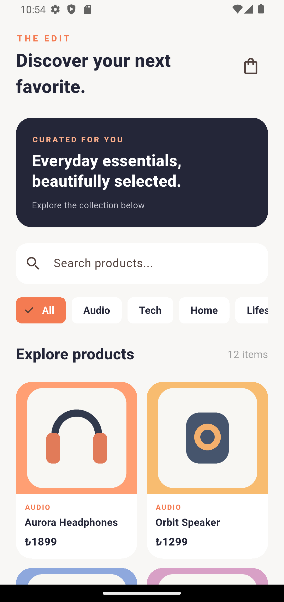
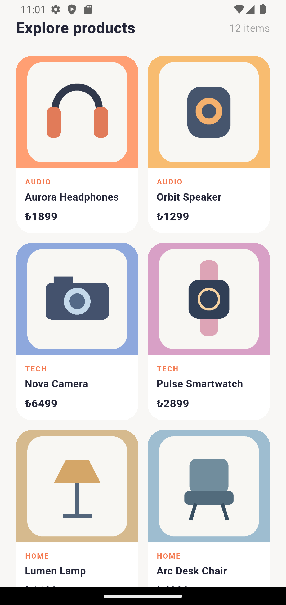
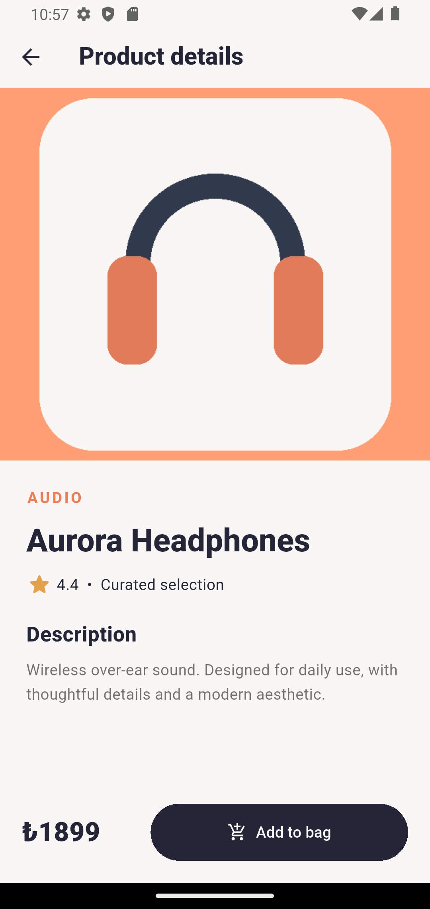
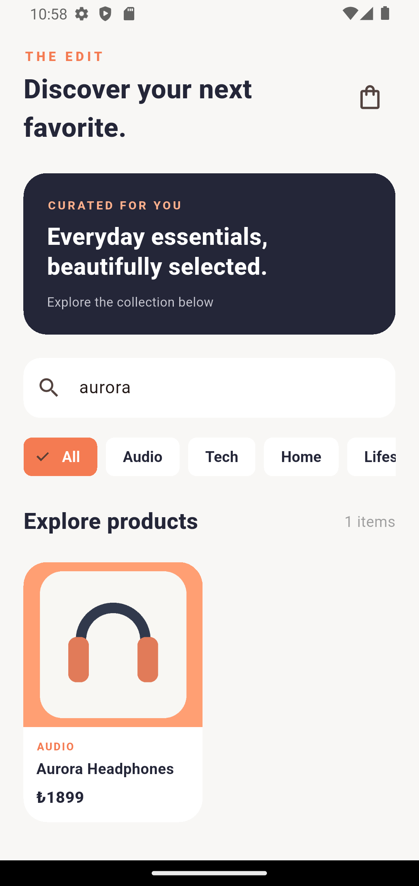
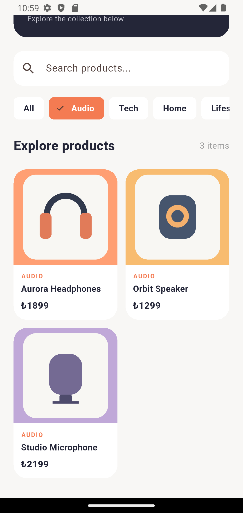
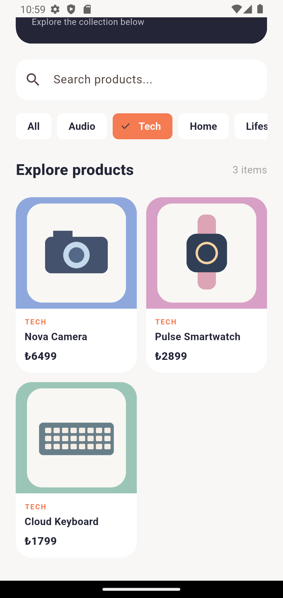
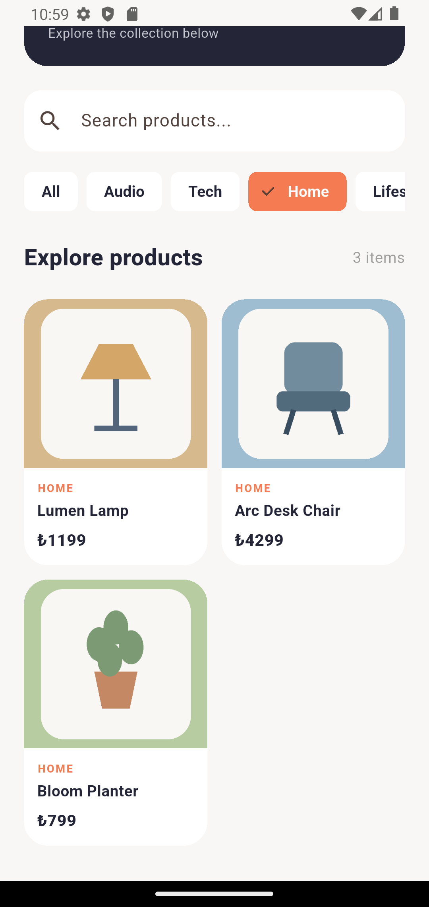
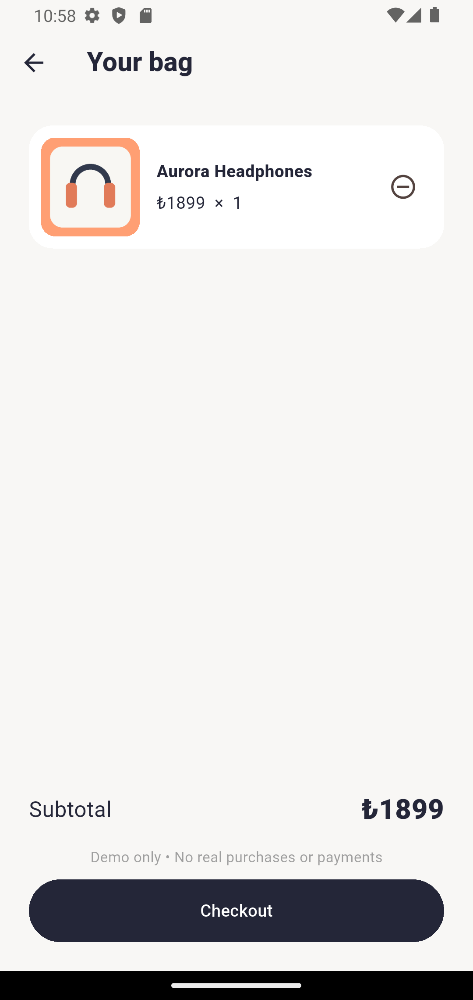
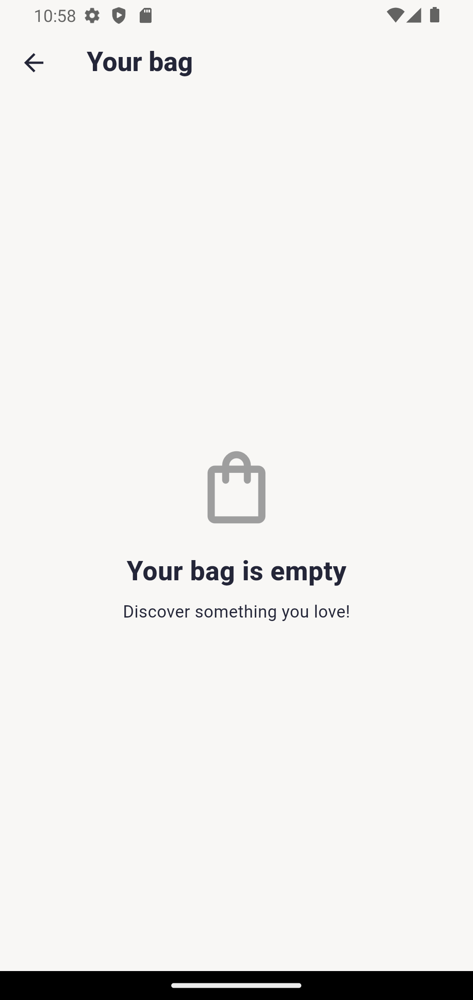

# The Edit — Flutter Mini Catalog

A polished, offline-first **Mini Catalog Application** built for the Flutter Android/iOS training project. The UI uses Material 3, curated product illustrations, and a clean, responsive layout.

## Features
- Discover screen with hero banner and product grid
- Search by product name/category and filter by category
- Product detail view with image, price, rating and description
- In-memory shopping bag: add products, change quantities by removing one, subtotal and demo checkout
- Empty bag and empty search states; loading and data-error states
- Local JSON product data and bundled product artwork (no internet required)

## Tech stack
- Flutter / Dart; Material widgets only at runtime
- Flutter SDK version: **record your installed version here** (`flutter --version`)
- Dart SDK >=3.0.0 <4.0.0
- No third-party runtime packages; No third-party dependencies

## Quick start (VS Code)
1. Install Flutter SDK, Dart/Flutter VS Code extensions and Android Studio + Android emulator.
2. Run `flutter doctor` and resolve any Android SDK/license issues.
3. If this ZIP does not contain native platform folders, run **`flutter create --platforms=android,ios .`** in this project directory. On Windows, Flutter may create the iOS scaffolding but iOS builds require macOS/Xcode.
4. Run `flutter pub get`.
5. Launch an emulator (or connect a physical Android phone with USB debugging).
6. Run `flutter devices` and then `flutter run` (or press F5 in VS Code).
7. Run `flutter test` and `flutter analyze` to check the project.

> Platform folders are generated by the installed Flutter SDK, ensuring compatibility with your local toolchain. No external API keys are required.

## Folder layout
```
lib/
  main.dart
  models/product.dart
  data/catalog_repository.dart
  screens/catalog_screen.dart
  screens/product_detail_screen.dart
  screens/cart_screen.dart
  widgets/product_card.dart
  theme/app_theme.dart
assets/
  data/products.json
  images/product_01.png ... product_12.png
test/product_test.dart
screenshots/README.md
```

## Requirements coverage
| Guideline requirement | Implementation |
| --- | --- |
| Stateless / Stateful widgets | `main.dart`, `catalog_screen.dart` |
| Navigation and route arguments | `main.dart`, `product_detail_screen.dart` |
| JSON, model, fromJson/toJson | `assets/data/products.json`, `models/product.dart` |
| ListView.builder | Horizontal category selector |
| GridView | Responsive product grid (`GridView.builder`) |
| Image.asset | Product cards, detail and cart |
| Search / filtering | Catalog screen |
| Cart simulation and setState | Catalog and cart screens |
| Asset organization | `assets/data`, `assets/images` |

## Screenshots
Add real emulator/device screenshots after running the app: `screenshots/catalog.png`, `screenshots/detail.png`, `screenshots/cart.png`, `screenshots/empty_cart.png`. The submission requires actual screenshots, not mockups.

## Important note
This is a **demonstration**, not an online store. Prices are fictional; no backend, account, payment, or order processing is implemented. Product illustrations were generated specifically for this project.

## Submission checklist
- [ ] App launches successfully on Android
- [ ] `flutter test` and `flutter analyze` pass
- [ ] Update the Flutter version above using your environment
- [ ] Capture and commit real screenshots
- [ ] Push all source files and screenshots to a **public GitHub repository**
- [ ] Submit the public GitHub repository URL

## License
Educational project; see `LICENSE`.


## Application Screenshots

The following screenshots were captured from The Edit running on a Pixel 4 Android emulator.


### Product Discovery

<table align="center">
  <tr>
    <td align="center">
      
      <br>
      <b>Home Screen</b>
      <br>
      <sub>Discover products and browse categories.</sub>
    </td>
    <td align="center">
      
      <br>
      <b>Product Catalog</b>
      <br>
      <sub>Explore the complete product collection.</sub>
    </td>
    <td align="center">
      
      <br>
      <b>Product Details</b>
      <br>
      <sub>View descriptions, prices, and product information.</sub>
    </td>
  </tr>
</table>


### Search & Category Filtering

<table align="center">
  <tr>
    <td align="center">
      
      <br>
      <b>Product Search</b>
    </td>
    <td align="center">
      
      <br>
      <b>Audio Category</b>
    </td>
  </tr>
  <tr>
    <td align="center">
      
      <br>
      <b>Tech Category</b>
    </td>
    <td align="center">
      
      <br>
      <b>Home Category</b>
    </td>
  </tr>
</table>


### Shopping Cart & More

<table align="center">
  <tr>
    <td align="center">
      
      <br>
      <b>Added to Cart</b>
      <br>
      <sub>Product added with updated subtotal.</sub>
    </td>
    <td align="center">
      
      <br>
      <b>Cart After Removal</b>
      <br>
      <sub>Empty cart after removing the product.</sub>
    </td>
  </tr>
</table>

<p align="center">
  <sub>Actual Android emulator screenshots. Shopping cart functionality is simulated; no real payments are processed.</sub>
</p>

